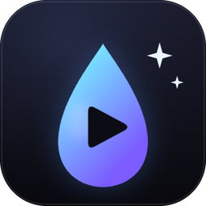
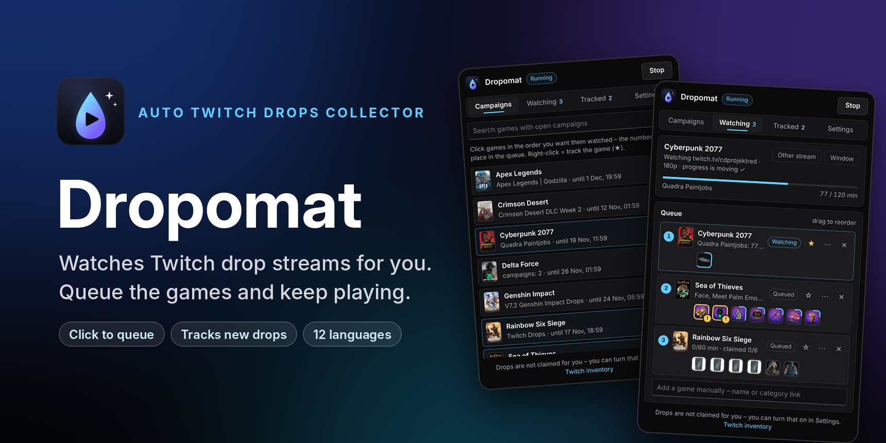
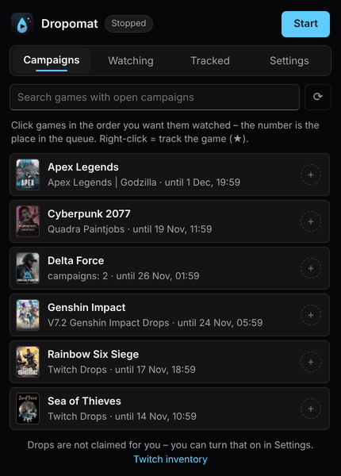
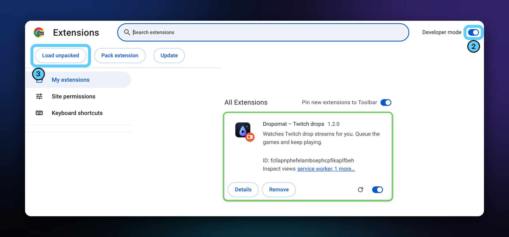
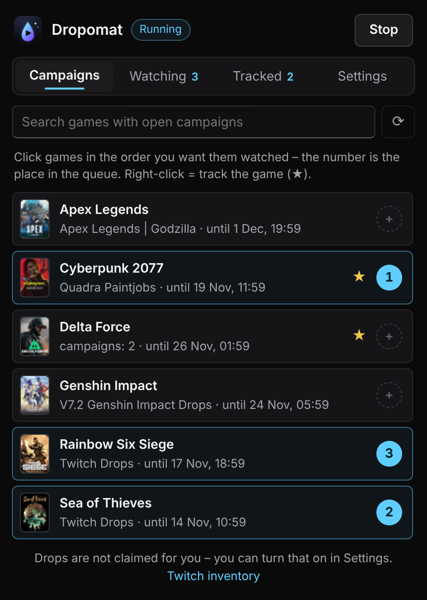
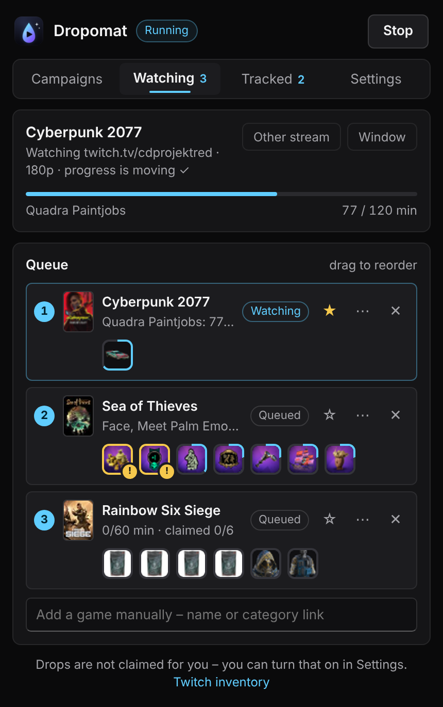
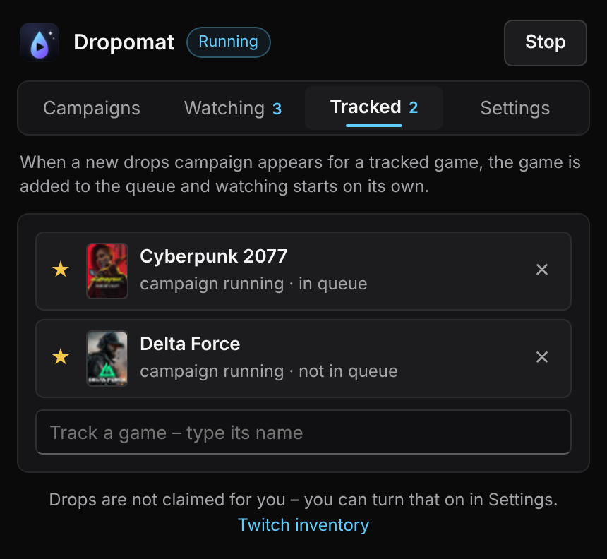
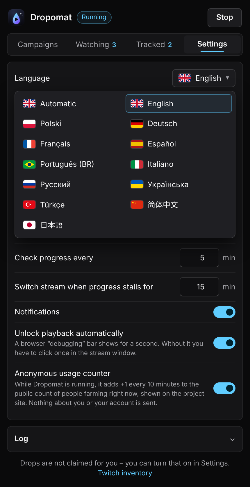

<h1 align="center">Dropomat – Auto Twitch Drops Collector</h1>

<b>Guarda al posto tuo gli stream di Twitch con i drop. Metti in coda i giochi e continua a giocare.</b>

           

  <a href="../dropomat.zip?raw=true"><b>⬇ Scarica (ZIP)</b></a> &nbsp;·&nbsp;
  <a href="https://yasaiek.github.io/Dropomat-Auto-Twitch-Drops/"><b>🌐 Website</b></a> &nbsp;·&nbsp;
  <a href="../../../../issues/new/choose">Segnala un bug</a> &nbsp;·&nbsp; Versione 1.2.2

## Cosa fa

- **Scegli e metti in coda** – Le campagne di drop aperte in un’unica lista. Fai clic sui giochi nell’ordine che vuoi: quella è la tua coda.
- **Guarda da solo** – Apre una finestra silenziata e ridotta a icona, sceglie uno stream in cui i drop del gioco funzionano davvero e passa oltre quando finisce.
- **Segue i nuovi drop** – Metti una stella a un gioco: quando compare una nuova campagna entra in coda e parte da solo.
- **Mostra il progresso reale** – Legge il progresso dal tuo account Twitch, mostra ogni drop con la sua icona e cambia stream se il progresso si ferma.
- **Riscatto facoltativo** – Può riscattare per te i drop ottenuti, solo se Twitch conferma che l’account di gioco è collegato.
- **12 lingue** – Tutta l’interfaccia in 12 lingue, modificabile in qualsiasi momento.

## Installazione in un minuto

1. Scarica lo ZIP ed estrailo in una cartella che terrai.
2. Apri chrome://extensions e attiva la Modalità sviluppatore (in alto a destra).
3. Fai clic su «Carica estensione non pacchettizzata» e scegli la cartella estratta.
4. Accedi su twitch.tv, apri Dropomat, fai clic sui giochi che vuoi e premi Avvia.

> Funziona in Chrome, Edge, Opera, Brave e altri browser Chromium.

### Aggiornamento

Sostituisci i file nella cartella e premi ⟳ accanto a Dropomat in chrome://extensions. Coda e impostazioni restano.

## Come si usa

| Campagne | In visione |
|:--:|:--:|
|  |  |
| Fai clic sui giochi nell’ordine in cui vanno guardati. Clic destro = segui un gioco. | Vedi cosa è in riproduzione, trascina i giochi per riordinare la coda e segui ogni drop. |

| Seguiti | Impostazioni |
|:--:|:--:|
|  |  |
| Giochi che partono da soli appena compare una nuova campagna. | Lingua, riscatto automatico, qualità dello stream, intervalli di controllo e registro. |

## Buono a sapersi

**Devo tenere lo stream sullo schermo?**  
No. Gira in una sua finestra silenziata che può restare ridotta a icona mentre giochi.

**Riscatta i drop al posto mio?**  
Solo se lo attivi nelle Impostazioni. Altrimenti il gioco passa a «Da riscattare» e la coda prosegue.

**È sicuro per il mio account?**  
La visione automatizzata è contraria ai termini di Twitch, quindi lo usi a tuo rischio. Il tuo accesso non lascia mai il browser.

**Perché manca una campagna nell’elenco?**  
Premi ⟳ nella scheda Campagne. Se manca ancora, aggiungi il gioco per nome nella scheda In visione oppure seguilo.

## Hai trovato un bug?

Apri una segnalazione su GitHub. Descrivi cosa è successo e incolla la riga «Lettura …» da Impostazioni → Registro.

➡ **[Segnala un bug](../../../../issues/new/choose)**

---

Dropomat non è affiliato a Twitch. Usalo a tuo rischio. · MIT
