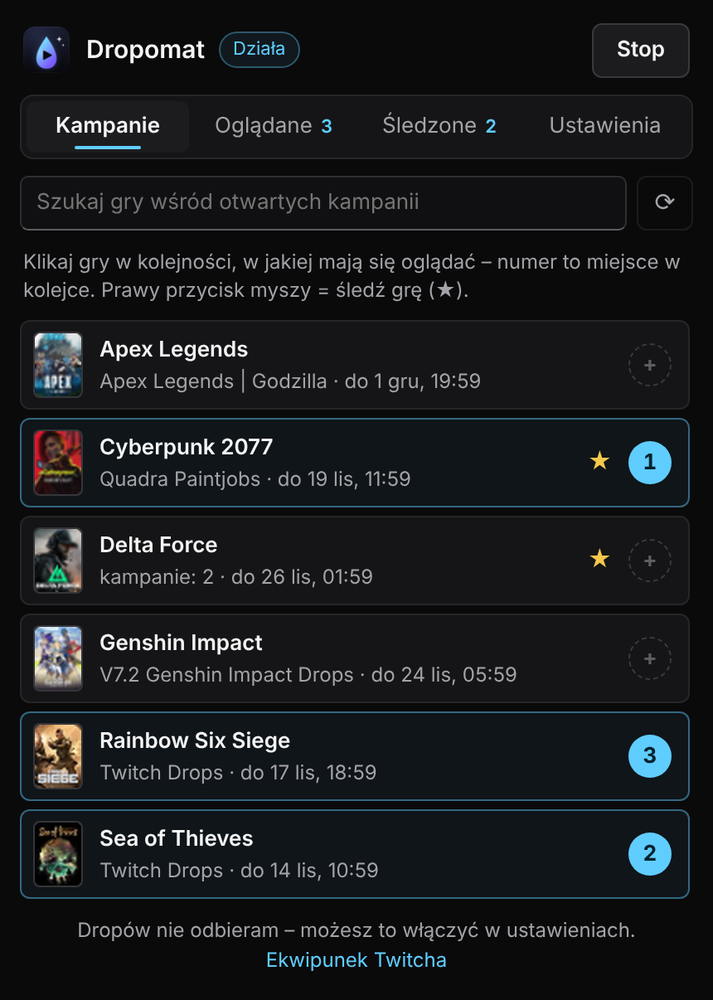
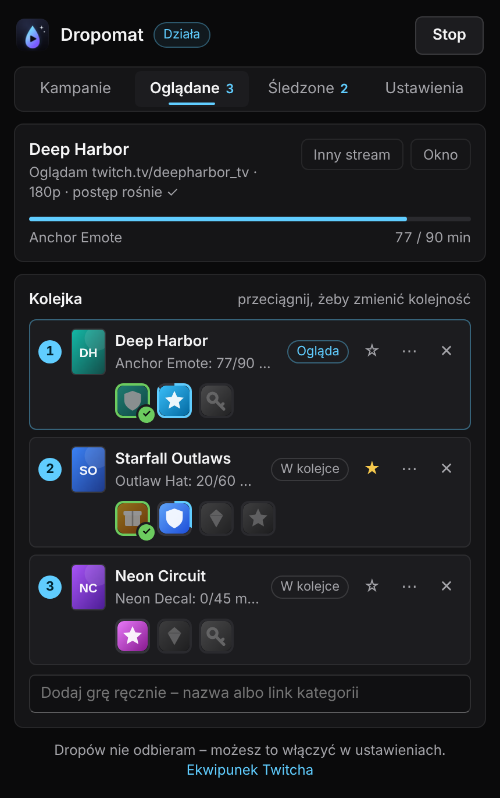
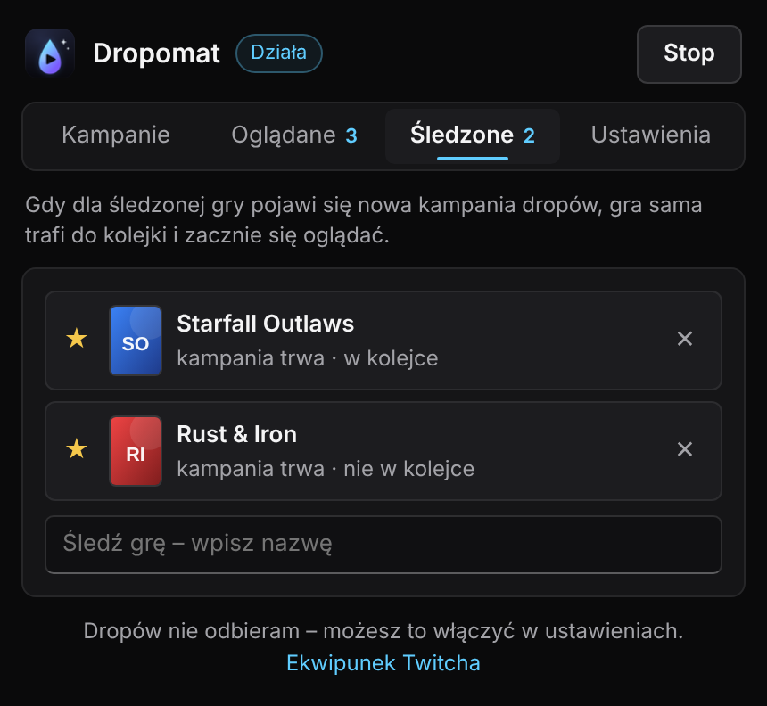
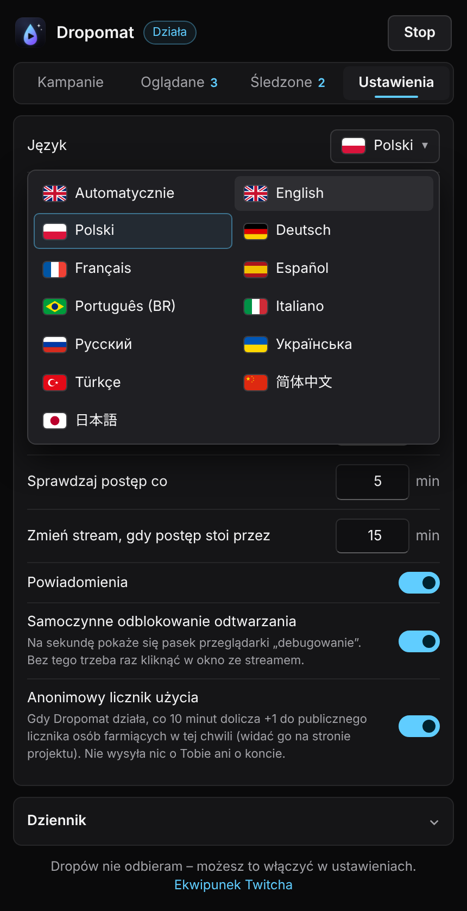

<h1 align="center">Dropomat – Auto Twitch Drops Collector</h1>

<b>Ogląda za Ciebie streamy z dropami na Twitchu. Ustaw kolejkę gier i graj dalej.</b>

           

  <a href="../dropomat.zip?raw=true"><b>⬇ Pobierz (ZIP)</b></a> &nbsp;·&nbsp;
  <a href="https://yasaiek.github.io/Dropomat-Auto-Twitch-Drops/"><b>🌐 Website</b></a> &nbsp;·&nbsp;
  <a href="../../../../issues/new/choose">Zgłoś błąd</a> &nbsp;·&nbsp; Wersja 1.2.3

## Co robi

- **Wybierasz i ustawiasz kolejkę** – Otwarte kampanie dropów na jednej liście. Klikasz gry w kolejności, w jakiej mają lecieć – to Twoja kolejka.
- **Ogląda samo** – Otwiera wyciszone, zminimalizowane okno, wybiera stream, na którym dropy tej gry naprawdę lecą, i przechodzi dalej, gdy się skończy.
- **Śledzi nowe dropy** – Oznacz grę gwiazdką: gdy pojawi się nowa kampania, gra sama trafi do kolejki i wystartuje.
- **Pokazuje prawdziwy postęp** – Czyta postęp z Twojego konta Twitch, pokazuje każdy drop z ikoną i zmienia stream, gdy postęp stoi.
- **Opcjonalne odbieranie** – Może odbierać wbite dropy za Ciebie – tylko gdy Twitch potwierdza, że konto gry jest połączone.
- **12 języków** – Cały interfejs w 12 językach, do zmiany w każdej chwili.

## Instalacja w minutę

1. Pobierz ZIP i rozpakuj go do folderu, którego nie będziesz usuwać.
2. Otwórz chrome://extensions i włącz Tryb dewelopera (prawy górny róg).
3. Kliknij „Załaduj rozpakowane” i wskaż rozpakowany folder.
4. Zaloguj się na twitch.tv, otwórz Dropomat, kliknij wybrane gry i naciśnij Start.

> Działa w Chrome, Edge, Operze, Brave i innych przeglądarkach na Chromium.

### Aktualizacja

Podmień pliki w folderze i kliknij ⟳ przy Dropomacie na chrome://extensions. Kolejka i ustawienia zostają.

## Jak używać

| Kampanie | Oglądane |
|:--:|:--:|
|  |  |
| Klikaj gry w kolejności, w jakiej mają się oglądać. Prawy przycisk myszy = śledź grę. | Widzisz, co leci teraz, przeciągasz gry, żeby zmienić kolejkę, i śledzisz każdy drop. |

| Śledzone | Ustawienia |
|:--:|:--:|
|  |  |
| Gry, które wystartują same, gdy tylko pojawi się nowa kampania. | Język, automatyczne odbieranie, jakość streama, częstotliwość sprawdzania i dziennik. |

## Warto wiedzieć

**Czy stream musi być na ekranie?**  
Nie. Leci w osobnym, wyciszonym oknie, które może być zminimalizowane, gdy grasz.

**Czy odbiera dropy za mnie?**  
Tylko jeśli włączysz to w Ustawieniach. W przeciwnym razie gra dostaje status „Do odebrania”, a kolejka idzie dalej.

**Czy to bezpieczne dla konta?**  
Automatyczne oglądanie jest wbrew regulaminowi Twitcha, więc używasz na własne ryzyko. Twoje logowanie nie opuszcza przeglądarki.

**Dlaczego na liście brakuje kampanii?**  
Kliknij ⟳ w zakładce Kampanie. Jeśli dalej jej nie ma, dodaj grę po nazwie w zakładce Oglądane albo zacznij ją śledzić.

## Znalazłeś błąd?

Załóż zgłoszenie na GitHubie. Opisz, co się stało, i wklej linijkę „Odczyt …” z Ustawienia → Dziennik.

➡ **[Zgłoś błąd](../../../../issues/new/choose)**

---

Dropomat nie jest powiązany z Twitchem. Używasz na własne ryzyko. · MIT
